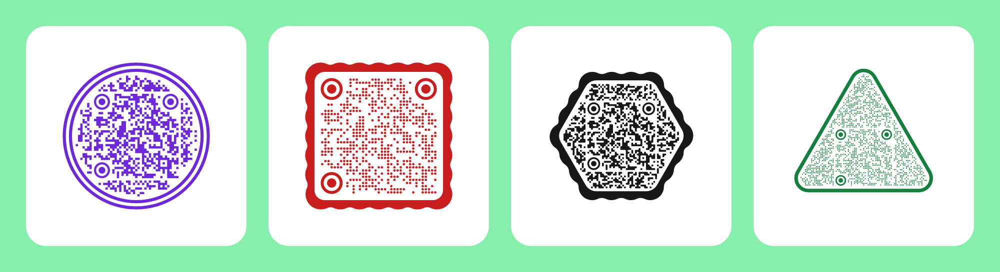
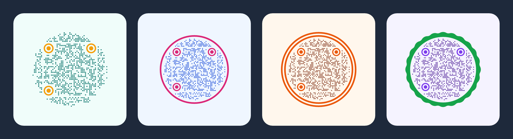
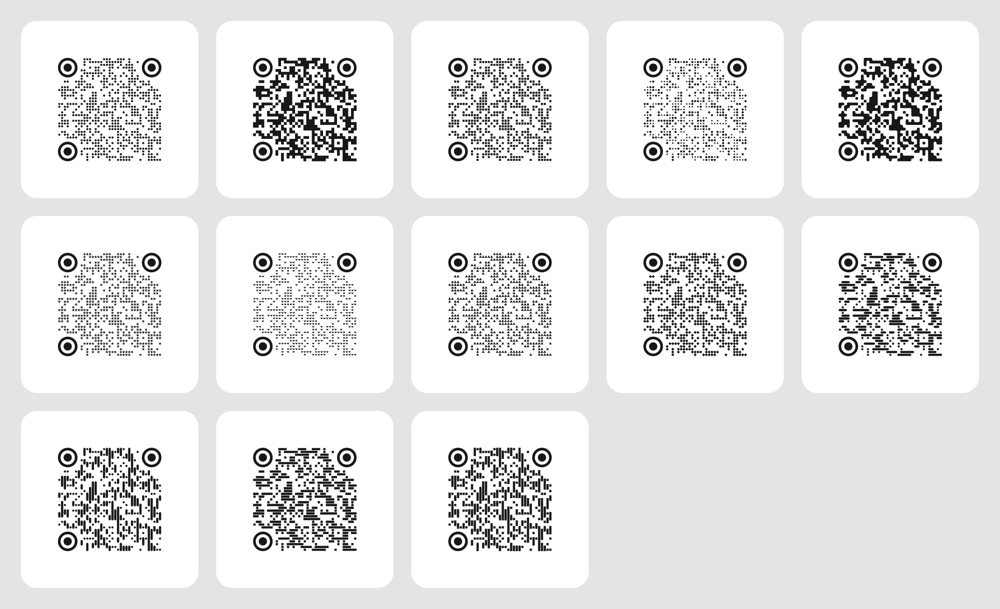
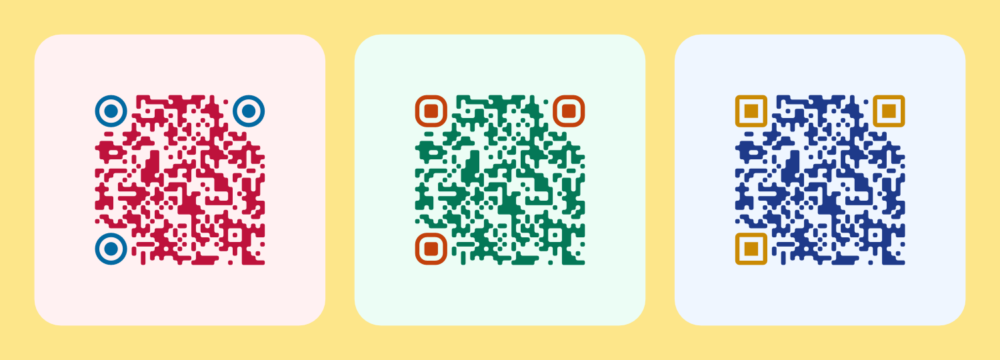
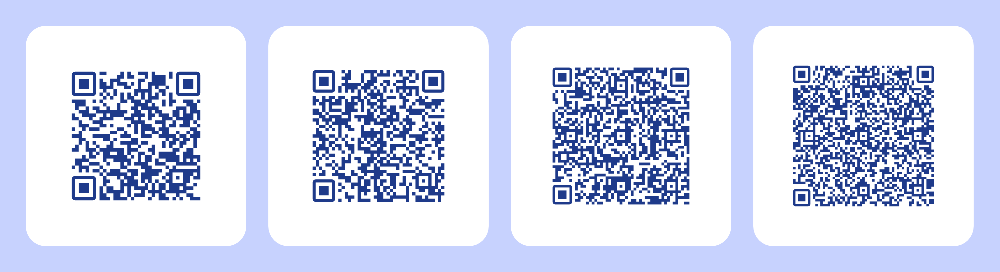

# qrcode-cute

[](composer.json)
[](LICENSE)
[](composer.json)

qrcode-cute is a PHP library that makes QR codes in four shapes: square,
circle, triangle and hexagon. The output is SVG, PNG or WebP. The library is
pure PHP. It does not use Composer packages, GD or Imagick.



A shaped code has the real matrix in the centre. Decorative modules fill the
remaining area of the shape. The default error correction level is H. This
level helps the scanner to read the code through the decoration.

Features:

- Four shapes: square, circle, triangle and hexagon.
- Four frames for each shape: none, thin, double and organic.
- Thirteen module patterns and three eye shapes. You can set the colour of each part.
- Error correction levels L, M, Q and H. Versions 1 to 40, with a maximum of 2953 bytes.
- SVG, PNG and lossless WebP output. The raster renderer is written in PHP and has anti-aliasing.
- Content types: Wi-Fi, e-mail, phone, SMS, geographic location, vCard, calendar event, Bitcoin, Litecoin and Ethereum.
- Use without Composer, with Composer, or in Laravel.
- The same input always gives the same output.

## Contents

- [Requirements](#requirements)
- [Installation](#installation)
- [Quick start](#quick-start)
- [Usage](#usage)
- [Content types](#content-types)
- [Laravel](#laravel)
- [Options](#options)
- [Error correction](#error-correction)
- [Shapes, frames, patterns and eyes](#shapes-frames-patterns-and-eyes)
- [Raster output](#raster-output)
- [Errors](#errors)
- [Scan results](#scan-results)
- [Examples](#examples)
- [Development](#development)
- [License](#license)

## Requirements

- PHP 8.0 or a newer version.
- The `ext-zlib` extension is optional. With zlib, the library compresses the
  PNG files. Without zlib, the PNG files have no compression, but they are
  correct. Most PHP builds have zlib. The WebP encoder does not need zlib.

## Installation

### With Composer

```bash
composer require wnikk/qrcode-cute
```

```php
require 'vendor/autoload.php';
```

### Without Composer

Copy the repository to your project. Then load its autoloader:

```php
require '/path/to/qrcode-cute/src/autoload.php';
```

The autoloader loads the classes of the `Wnikk\QrCodeCute\` namespace from
the `src/` directory. Only the `src/` directory is necessary.

## Quick start

`QrCode` is the only class that you need. Make a code in one call:

```php
use Wnikk\QrCodeCute\QrCode;

echo QrCode::svg('https://example.com', ['shape' => 'circle']);

$png = QrCode::png('https://example.com', ['shape' => 'circle'], 512);
$webp = QrCode::webp('https://example.com', ['shape' => 'circle'], 512);
```

Or set the design with the fluent setters:

```php
$qr = (new QrCode)
    ->shape('hexagon')
    ->frame('thin')
    ->pattern('rounded')
    ->color('#0f172a')
    ->wifi('Office', 'secret');

$qr->save('wifi.svg');          // The file extension sets the format.
$qr->save('wifi.png', 1024);    // A PNG file, 1024 x 1024 pixels.
$qr->save('wifi.webp', 1024);   // A lossless WebP file.
```

The constructor also accepts the text and an options array:
`new QrCode('https://example.com', ['shape' => 'circle'])`. The two ways
give the same code.

## Usage

### SVG

```php
$svg = $qr->toSvg();          // '<svg xmlns="..." viewBox="0 0 440 440">…</svg>'
$svg = $qr->toSvg(true);      // Adds an XML declaration for a standalone file.
```

The result is a complete `<svg>` element. You can put it in HTML, keep it in
a file, or send it as `image/svg+xml`. A `QrCode` object also converts to a
string. Thus `echo $qr;` writes the SVG.

### PNG and WebP

```php
$png = $qr->toPng();          // The default size is 1024 x 1024 pixels.
$png = $qr->toPng(512);       // The size can be 1 to 8192 pixels.
$webp = $qr->toWebp(512);     // Lossless WebP. Transparency is kept.

$data = $qr->render('webp', 512);     // The format as a parameter: svg, png or webp.
$type = QrCode::mimeType('webp');     // 'image/webp'
```

### Data URIs

```php
echo 'toDataUri('svg').'" alt="QR code">';
echo 'toDataUri('webp', 300).'" alt="QR code">';
```

### HTTP response

```php
header('Content-Type: '.QrCode::mimeType('png'));
header('Cache-Control: public, max-age=86400');
echo (new QrCode($url, ['shape' => 'circle']))->toPng(512);
```

The same options always give the same image. Thus you can keep the response
in a cache.

### One design for many codes

A `QrCode` object is immutable. Each setter, `text()` and each content method
give a new object. The original object does not change. Thus one object can
keep your design:

```php
$brand = (new QrCode)->color('#be123c')->frame('thin');

$brand->text('https://example.com/a')->save('a.png', 800);
$brand->text('https://example.com/b')->save('b.png', 800);

foreach (QrCode::SHAPES as $shape) {
    $brand->shape($shape)->text('https://example.com')->save("qr-$shape.png", 800);
}
```

The `with()` method changes many options at once:
`$brand->with(['shape' => 'circle', 'pattern' => 'stars'])`.

### Changes to the SVG tree

The `toSvgNode()` method gives the SVG as a tree of nodes. Change the tree,
then serialize it with `toXml()`. The raster renderer also draws a changed
tree.

```php
use Wnikk\QrCodeCute\Raster\Rasterizer;

$node = $qr->toSvgNode();
$node->setAttribute('role', 'img');
$node->setAttribute('aria-label', 'Link to example.com');

$svg = $node->toXml();
$png = Rasterizer::png($node, 800);
$webp = Rasterizer::webp($node, 800);
```

### The module matrix

```php
$matrix = $qr->getMatrix();   // bool[][]: the value true is a dark module.
```

## Content types

A content method sets the payload text in the correct format. Then use an
output method. Use named arguments for the optional parameters. A bad value
causes an `InvalidOptionException`.

```php
$qr = (new QrCode)->shape('circle')->wifi('Office', 'secret');

echo $qr;                       // The SVG.
$png = $qr->toPng(512);
$text = $qr->getText();         // 'WIFI:T:WPA;S:Office;P:secret;;'
```

| Method | Example | Payload text |
| --- | --- | --- |
| `wifi()` | `->wifi('Office', 'secret')` | `WIFI:T:WPA;S:Office;P:secret;;` |
| `email()` | `->email('info@example.com', subject: 'Hello')` | `mailto:info@example.com?subject=Hello` |
| `phone()` | `->phone('+1 555 123 4567')` | `tel:+15551234567` |
| `sms()` | `->sms('+15551234567', 'Meet at 5')` | `SMSTO:+15551234567:Meet at 5` |
| `geo()` | `->geo(55.751244, 37.618423)` | `geo:55.751244,37.618423` |
| `vcard()` | `->vcard(firstName: 'Ivan', lastName: 'Petrov', phone: '+15551234567')` | `BEGIN:VCARD` … `END:VCARD` (vCard 3.0) |
| `calendar()` | `->calendar('Meeting', '2026-12-01 10:00 UTC', location: 'Room 1')` | `BEGIN:VEVENT` … `END:VEVENT` |
| `bitcoin()` | `->bitcoin('bc1q…', 0.0012, label: 'Shop')` | `bitcoin:bc1q…?amount=0.0012&label=Shop` (BIP 21) |
| `litecoin()` | `->litecoin('ltc1q…', '1.5')` | `litecoin:ltc1q…?amount=1.5` |
| `ethereum()` | `->ethereum('0x8920…43e7', '1000000000000000000', chainId: 1)` | `ethereum:0x8920…43e7@1?value=1000000000000000000` (EIP 681) |
| `text()` | `->text('Any text')` | `Any text` |

Some details:

- `wifi()`: the encryption is `WPA`, `WEP` or `nopass`. An empty password gives an open network. The method escapes the characters `\ ; , : "`.
- `email()`: `cc` and `bcc` accept one address or a list. The subject and the body are percent-encoded.
- `phone()` and `sms()`: the methods remove spaces and the characters `( ) .`.
- `vcard()`: the parameters are `name`, `firstName`, `lastName`, `organization`, `title`, `phone`, `email`, `url`, `address` and `note`. `phone` and `email` accept one value or a list.
- `calendar()`: `start` and `end` accept a `DateTimeInterface` or a date string. A time changes to UTC. Without `end`, an event takes one hour. With `allDay: true`, the event uses dates only.
- `bitcoin()` and `litecoin()`: give the amount as a string for an exact decimal value.
- `ethereum()`: the value is in wei, as an integer. Give a large value as a string.

## Laravel

The library has a service provider. Laravel finds it automatically. The
provider registers `QrCode` in the container as a shared object with the
default design. You do not need other configuration.

```php
use Illuminate\Http\Response;
use Wnikk\QrCodeCute\QrCode;

class QrCodeController
{
    public function show(QrCode $qr): Response
    {
        $png = $qr->shape('hexagon')->text(url('/'))->toPng(512);

        return response($png)->header('Content-Type', QrCode::mimeType('png'));
    }
}
```

The shared object does not change, because each setter gives a new object.

In a Blade template, write the SVG without escaping:

```blade
{!! QrCode::svg($url, ['shape' => 'circle']) !!}
```

Add `use Wnikk\QrCodeCute\QrCode;` to the template, or write the full class
name. To set your design in one location, bind the object in a service
provider of your application:

```php
$this->app->singleton(QrCode::class, fn () => (new QrCode)->shape('circle')->color('#1d4ed8'));
```

## Options

All options are optional. Each option has a setter with the same name, for
example `->eyeColor('#db2777')`. An unknown option or value causes an
exception. The library does not replace a bad value with a default.

| Option | Type | Default | Values |
| --- | --- | --- | --- |
| `shape` | string | `'square'` | `square`, `circle`, `triangle`, `hexagon` |
| `frame` | string | `'none'` | `none`, `thin`, `double`, `organic` |
| `pattern` | string | `'dots'` | The module shape. Refer to [Patterns](#patterns). |
| `eyeShape` | string | `'circle'` | `circle`, `rounded`, `square` |
| `color` | string | `'#000000'` | The module colour. |
| `background` | string | `'#ffffff'` | The background colour, or `'transparent'`. |
| `eyeColor` | string\|null | `null` | The colour of the finder eyes. The value `null` gives `color`. |
| `frameColor` | string\|null | `null` | The colour of the frame. The value `null` gives `color`. |
| `errorCorrection` | string | `'H'` | `L`, `M`, `Q`, `H`. Refer to [Error correction](#error-correction). |
| `seed` | int\|float | `0` | The seed for the `star` pattern and for the decorative fill of shaped codes. |
| `mask` | int\|null | `null` | A QR mask, 0 to 7. The mask changes the look, not the content. The value `null` lets the encoder select the mask. |

The lists of values are class constants. Use them to make a form:

```php
QrCode::SHAPES; QrCode::FRAMES; QrCode::PATTERNS; QrCode::EYE_SHAPES;
QrCode::ERROR_CORRECTION_LEVELS; QrCode::FORMATS; QrCode::DEFAULTS;
```

The encoder writes the payload as bytes. Give the text in UTF-8.

## Error correction

The error correction level sets how much damage the code can have. A lower
level holds more data in a code of the same size. The encoder uses the
smallest version (1 to 40) that holds the payload.

| Level | Damage that the code can have | Maximum payload (version 40) |
| --- | --- | --- |
| `L` | approximately 7% | 2953 bytes |
| `M` | approximately 15% | 2331 bytes |
| `Q` | approximately 25% | 1663 bytes |
| `H` (default) | approximately 30% | 1273 bytes |

If the payload is too long for the level, the library causes a
`DataTooLongException`. The message tells you if a lower level can hold the
payload.

```php
$qr = new QrCode($longText, ['errorCorrection' => 'L', 'pattern' => 'square']);
$qr->save('long.png', 2400);
```

A large version has many small modules. For a large version, use the
`square` pattern and a large image size. Refer to [Scan results](#scan-results).

## Shapes, frames, patterns and eyes

### Shapes

The `square` shape shows only the matrix. The `circle`, `triangle` and
`hexagon` shapes put the matrix in the outline. Decorative modules in the same
pattern fill the remaining area. In the triangle, the matrix is in the low
part, where the triangle is widest.

### Frames

All shapes have all frames. The frame follows the outline of the shape. From
left to right: `none`, `thin`, `double`, `organic`. Each code in the image
has different colours for the modules, the eyes and the frame.



### Patterns



The order of the codes is the order of `QrCode::PATTERNS`, from left to right
and from top to bottom:

1. `dots`, `square`, `small`, `star`, `rounded`
2. `stars`, `hearts`, `triangles`, `diamonds`, `pill-h`
3. `pill-v`, `bar-h`, `bar-v`

The `star` pattern has dots of two sizes. The `seed` option sets their
positions. The `rounded`, `pill-*` and `bar-*` patterns merge adjacent
modules into one shape.

### Eye shapes

From left to right: `circle`, `rounded`, `square`. In each code, the
`eyeColor` is different from the `color`.



## Raster output

The raster renderer is a part of the library and is written in PHP. It fills
each shape with exact horizontal coverage on five sub-scanlines in each pixel
row. Thus the edges are smooth. The renderer fills adjacent modules of one
colour together. Thus no thin lines are visible between the modules.

- **Speed:** approximately 0.2 s for a 1024 x 1024 PNG on PHP 8.4. The WebP
  encoder adds approximately 0.1 s. The time increases with the number of pixels.
- **Memory:** approximately 4 bytes for each pixel, and approximately 15 MB of
  working memory. A 1024 x 1024 image uses less than 20 MB.
- **PNG:** RGB for an opaque image. RGBA for a transparent background.
- **WebP:** lossless (VP8L), with transparency. The file size is approximately
  the PNG size.
- **Colours:** hex (`#rgb`, `#rgba`, `#rrggbb`, `#rrggbbaa`), `rgb()`,
  `rgba()`, `hsl()`, `hsla()`, the CSS colour names and `transparent`.

The SVG output accepts all CSS colours. The raster renderer does not know
some of them, for example `var(--brand)`. For such a colour, the raster
renderer causes a `RenderException`.

`Rasterizer` also draws a tree that you made or changed. These elements are
possible: `<svg>`, `<g>`, `<rect>`, `<circle>`, `<ellipse>`, `<line>`,
`<polyline>`, `<polygon>` and `<path>`. These attributes are possible:
`transform`, `fill`, `fill-rule`, `stroke`, `stroke-width` and the opacity
attributes. The renderer does not draw text, gradients, clipping, masks,
filters or CSS.

## Errors

All exceptions of the library use the interface
`Wnikk\QrCodeCute\Exception\QrCodeException`.

| Exception | Cause |
| --- | --- |
| `InvalidOptionException` | An unknown option or value, an empty text, or a bad content type value. |
| `DataTooLongException` | The payload is too long for the error correction level. |
| `RenderException` | The raster renderer does not know a colour, the image size is not correct, or the library cannot write a file. |

```php
use Wnikk\QrCodeCute\Exception\QrCodeException;

try {
    $png = (new QrCode($input, $options))->toPng(512);
} catch (QrCodeException $e) {
    // Show $e->getMessage() to the user.
}
```

## Scan results

During development, we made images for each combination of shape, frame,
pattern and error correction level. The Apple Vision barcode reader decoded
these images. The table shows the results at level H.

| Payload | Result |
| --- | --- |
| Up to approximately 75 bytes (a usual URL) | All shapes, frames, patterns and eye shapes decode. Levels L, M and Q also decode. |
| Approximately 100 to 190 bytes | The triangle with separate modules (`dots`, `star`, `stars`, `hearts`, `small`, `triangles`) can fail. All other combinations decode. |
| More than approximately 190 bytes | The circle and the hexagon with `dots`, `star`, `stars` or `hearts` can also fail. The triangle can fail with more patterns. |

The `square` shape decoded with all patterns at all tested lengths, up to 300
bytes at level H. The merged patterns (`square`, `rounded`, `pill-*`, `bar-*`)
on the circle and the hexagon also decoded at all tested lengths. For a long
payload, use one of these combinations.

A version 40 code at level L (2953 bytes) decoded with the `square` shape, the
`square` pattern and an image size of 2400 pixels. With the `dots` pattern, it
did not decode.

All content types decoded to the same text that the content methods make.
The WebP files decoded with the same result as the PNG files.

Contrast is important. A light code on a light background does not cause an
error, but the scanner cannot read it easily. Make the code much darker than
the background. Test the code at the printed size.

## Examples

The [docs/](docs/README.md) directory has six examples. Each example is one
PHP script and the image that the script makes: shapes, frames, patterns, eye
shapes, content types and error correction levels.



Make all images again after a change to the drawing:

```bash
composer docs
```

## Development

Install the development packages:

```bash
composer install
```

Run the tests (PHPUnit, with Orchestra Testbench for the Laravel provider):

```bash
composer test
```

Run the static analysis (PHPStan, level 8):

```bash
composer analyse
```

Format the code (Laravel Pint, the Laravel preset):

```bash
composer format
```

## License

MIT. Refer to [LICENSE](LICENSE). The LICENSE file also gives the original
authors.
