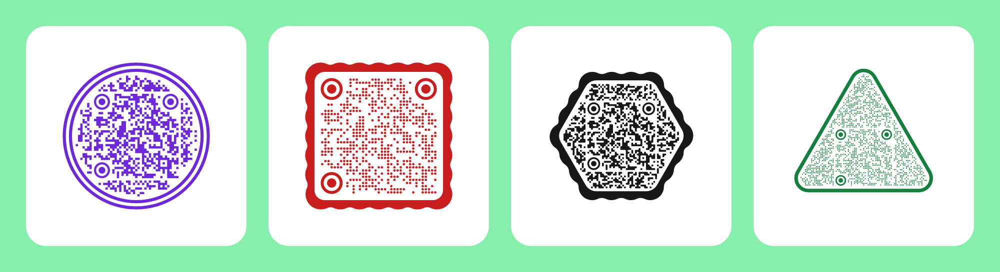
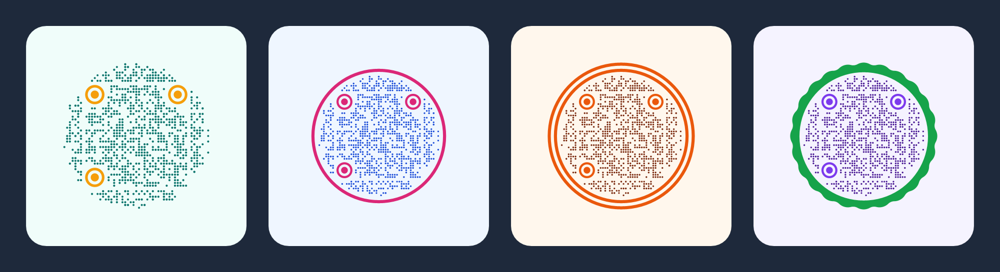
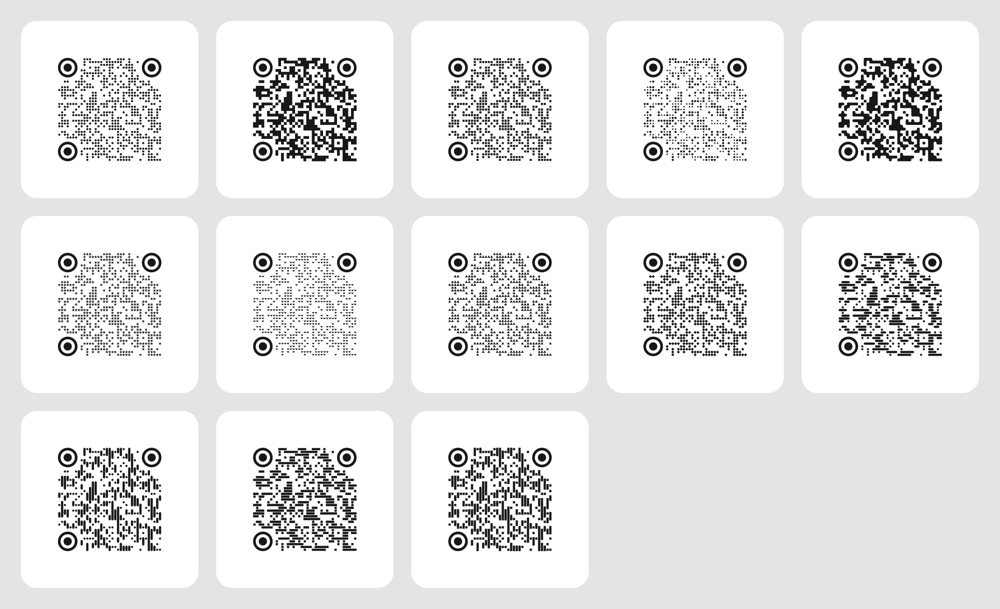
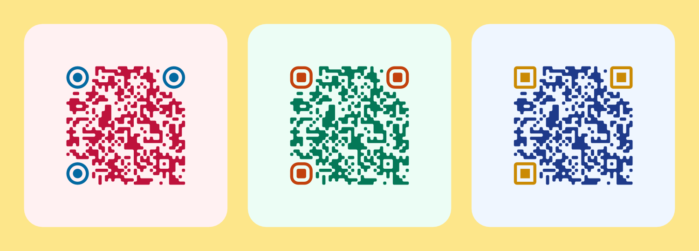
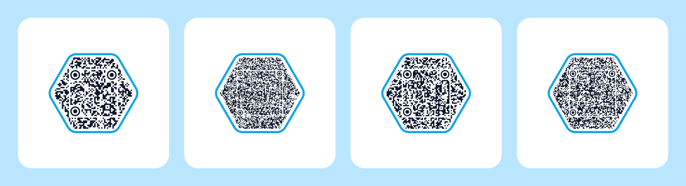

# Examples

Each example is one PHP script and the image that the script makes. The
library's own raster renderer draws all images. Thus each image is the same
as the output of `QrCode::toPng()` or `QrCode::toWebp()`.

Run one example:

```bash
php docs/example1-shapes.php
```

Run all examples:

```bash
composer docs
```

All examples use [`scene.php`](scene.php). This helper loads the library and
puts the codes on cards in a grid. The QR code part of each example is in the
example script.

| # | Example | Script | Image |
| --- | --- | --- | --- |
| 1 | [Shapes](#1-shapes) | [example1-shapes.php](example1-shapes.php) | PNG |
| 2 | [Frames](#2-frames) | [example2-frames.php](example2-frames.php) | PNG |
| 3 | [Patterns](#3-patterns) | [example3-patterns.php](example3-patterns.php) | PNG |
| 4 | [Eye shapes](#4-eye-shapes) | [example4-eyes.php](example4-eyes.php) | PNG |
| 5 | [Content types](#5-content-types) | [example5-content-types.php](example5-content-types.php) | WebP |
| 6 | [Error correction](#6-error-correction) | [example6-error-correction.php](example6-error-correction.php) | PNG |

## 1. Shapes

The four shapes, each with a frame. From left to right: circle with a double
ring, square with a wavy frame, hexagon with a wavy frame, triangle with a
thin frame.



```php
new QrCode($url, ['shape' => 'circle', 'frame' => 'double', 'pattern' => 'square', 'color' => '#6d28d9']);
new QrCode($url, ['shape' => 'square', 'frame' => 'organic', 'pattern' => 'dots', 'color' => '#c81e1e']);
new QrCode($url, ['shape' => 'hexagon', 'frame' => 'organic', 'pattern' => 'rounded', 'color' => '#18181b']);
new QrCode($url, ['shape' => 'triangle', 'frame' => 'thin', 'pattern' => 'dots', 'color' => '#15803d']);
```

## 2. Frames

One circular code with the four frames. From left to right: `none`, `thin`,
`double`, `organic`. Each code has its own colours for the modules, the eyes,
the frame and the background.



```php
new QrCode($url, [
    'shape' => 'circle',
    'frame' => 'thin',
    'color' => '#1d4ed8',
    'eyeColor' => '#db2777',
    'frameColor' => '#db2777',
    'background' => '#eff6ff',
]);
```

## 3. Patterns

The thirteen module patterns. The order is the order of `QrCode::PATTERNS`,
from left to right and from top to bottom:

1. `dots`, `square`, `small`, `star`, `rounded`
2. `stars`, `hearts`, `triangles`, `diamonds`, `pill-h`
3. `pill-v`, `bar-h`, `bar-v`



```php
foreach (QrCode::PATTERNS as $pattern) {
    $codes[] = new QrCode($url, ['pattern' => $pattern, 'color' => '#18181b']);
}
```

The `star` pattern has dots of two sizes. The `seed` option sets their
positions. The `rounded`, `pill-*` and `bar-*` patterns merge adjacent modules
into one shape.

## 4. Eye shapes

The three eye shapes. From left to right: `circle`, `rounded`, `square`. In
each code, the eye colour is different from the module colour.



```php
new QrCode($url, [
    'eyeShape' => 'rounded',
    'pattern' => 'rounded',
    'color' => '#047857',
    'eyeColor' => '#c2410c',
    'background' => '#ecfdf5',
]);
```

## 5. Content types

Four content types with one design. From left to right: a Wi-Fi network, a
contact card, a location and a Bitcoin payment. This image is a lossless WebP
file.



```php
$design = (new QrCode)
    ->shape('hexagon')
    ->frame('thin')
    ->pattern('rounded')
    ->color('#0f172a')
    ->frameColor('#0ea5e9');

$design->wifi('Office', 'secret');
$design->vcard(firstName: 'Ivan', lastName: 'Petrov', phone: '+15551234567', email: 'ivan@example.com');
$design->geo(55.751244, 37.618423, 'Red Square');
$design->bitcoin('bc1qar0srrr7xfkvy5l643lydnw9re59gtzzwf5mdq', '0.0012', 'Shop');
```

Each content method gives a new `QrCode` object. The `$design` object does
not change. To get the image data, use an output method, for example
`$design->wifi('Office', 'secret')->toWebp(512)`.

## 6. Error correction

One payload of 101 bytes at the four error correction levels. From left to
right: `L`, `M`, `Q`, `H`. A higher level adds more error correction data.
Thus the matrix has more modules: 37, 41, 49 and 57 modules on one side.


```php
foreach (QrCode::ERROR_CORRECTION_LEVELS as $level) {
    $codes[] = new QrCode($text, ['errorCorrection' => $level, 'pattern' => 'square', 'eyeShape' => 'square']);
}
```
